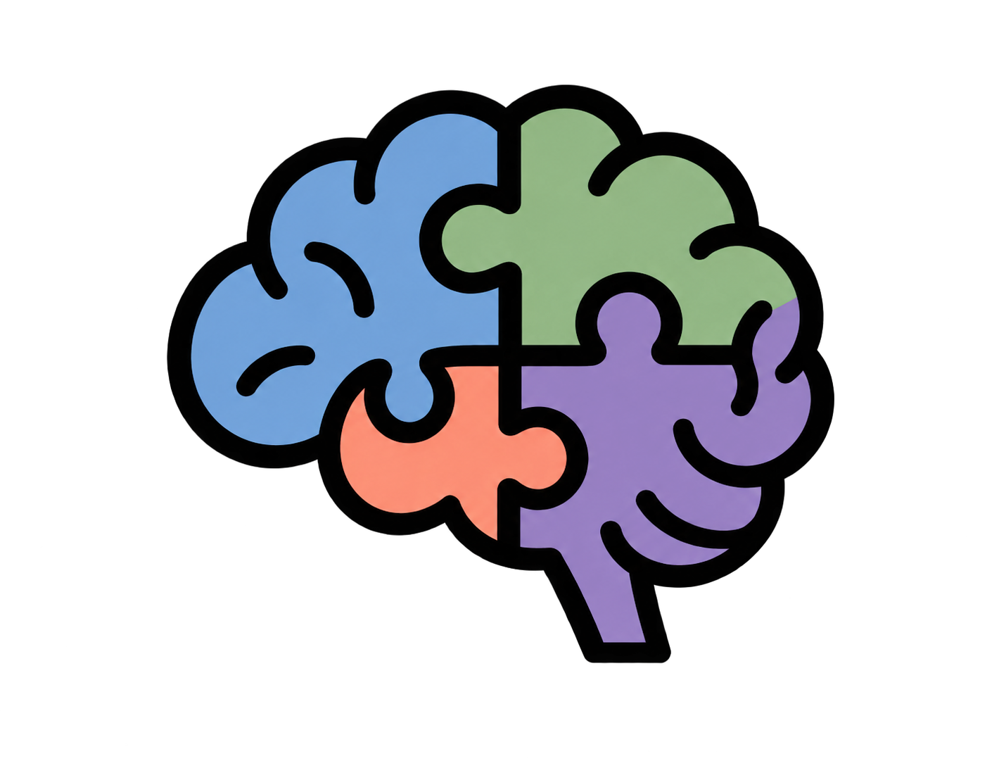

<div align="center">



# NeuroVita

**Agendamento de consultas e acompanhamento de pacientes para clínicas de psicologia e psiquiatria.**


[Sobre](#-sobre-o-projeto) ·
[Funcionalidades](#-funcionalidades-por-perfil) ·
[Como rodar](#-como-rodar) ·
[Acesso](#-acesso-ao-sistema) ·
[Back-end](#-ligando-ao-back-end)

</div>

---

## 📖 Sobre o projeto

O **NeuroVita** é um sistema web para clínicas que atendem pacientes de neurodesenvolvimento (como TEA e TDAH). Ele organiza a agenda, o cadastro de pacientes e profissionais e o prontuário, com um painel diferente para cada tipo de usuário.

`frontend final/` é o frontend oficial do NeuroVita. A interface Angular preserva o protótipo atualizado e usa os serviços HTTP para autenticação, preferências e operações clínicas disponibilizadas pelo backend Spring Boot na raiz do repositório. `frontend/` permanece apenas como referência funcional e não deve substituir esta interface.

Os dados exibidos nas telas logadas vêm da API. Dados demonstrativos só devem ser usados em exemplos e não substituem operações persistidas.

## ✨ Funcionalidades por perfil

O sistema tem **4 perfis**. As telas são parecidas, mas o menu, os botões e as permissões mudam conforme quem entrou.

| Perfil | O que faz |
| --- | --- |
| 🧠 **Psicólogo** | Vê a agenda do dia e o calendário. Consulta pacientes e abre o **prontuário** com evoluções, laudos, encaminhamentos, avaliações psicológicas e atestados. Acompanha a **agenda semanal** e altera o status das consultas. |
| 🩺 **Psiquiatra** | Mesmo fluxo do psicólogo, com as seções do prontuário próprias da psiquiatria: evoluções, laudos, **medicamentos e prescrições**, **atestados médicos** e **solicitação de exames**. |
| 🗂️ **Secretária** | Acompanha os números do dia. **Cadastra, edita e exclui pacientes**, **agenda consultas** vendo só os horários livres e, na agenda, **confirma, remarca ou cancela** consultas. |
| 🛠️ **Administrador** | Visão geral da clínica. Só consulta pacientes. **Cadastra, edita, inativa e exclui profissionais** (com dias, horários e tipo de atendimento) e **secretárias**, e acompanha a agenda. |

### Destaques

- **Editor de texto** para os documentos do prontuário, com estilos, tamanho, negrito, itálico, sublinhado, cor, alinhamento, links, imagens, listas e tela cheia.
- **Disponibilidade do profissional valendo de verdade:** ao agendar, só aparecem os horários dos dias, faixas e tipo de atendimento (online ou presencial) que o profissional atende, sem choque com outras consultas.
- **Sem dados sensíveis na tela inicial:** a agenda do dia e as próximas consultas mostram só o status (Confirmado, Pendente, Cancelada), nunca o diagnóstico. O diagnóstico só aparece dentro do prontuário.
- **Horários de 1 em 1 hora, das 08:00 às 18:00** na agenda, na janela "Editar consulta" e no agendamento (a pausa do almoço e os horários já ocupados aparecem indisponíveis, conforme a disponibilidade de cada profissional).
- **Agenda organizada:** linhas de 1 hora, e cada consulta fica dentro do quadrado da hora em que começa, com o horário exato (ex.: 08:00 - 09:00), o nome, o tipo de atendimento (presencial ou online) e o profissional.
- **Dados compartilhados entre os perfis:** o que a secretária agenda aparece na agenda do psicólogo, e o que o administrador cadastra aparece nas listas dos outros.
- **Proteção ao excluir:** um profissional com consultas marcadas não pode ser excluído, apenas inativado.
- **Tela inicial dos 4 perfis:** a "Agenda do dia" é uma tabela (horário, paciente, telefone, profissional e status) com as consultas de hoje vindas da agenda. Psicólogo e psiquiatra têm o banner no topo; secretária e administrador têm os 4 cards de números (do dia, confirmadas, pendentes e canceladas) e os botões de gerenciar.
- **Cadastro e edição de paciente (um só formulário para todos os perfis):** dados pessoais (nome, nascimento, CPF, CEP, cidade, endereço, datas de início e encerramento, status) e responsável (nome, CPF, telefone, e-mail, endereço, parentesco), como no Figma. O CEP é obrigatório no cadastro; o responsável é obrigatório para menores de 18 anos.
- **Formulários validados:** CPF (com dígito verificador), telefone, e-mail, datas e responsável obrigatório para menores de 18 anos, com máscaras de CPF e telefone.
- **Prontuário e galeria de documentos:** o prontuário mostra os dados do paciente, as últimas informações (próxima e última consulta, vindas da agenda) e um cartão para cada seção (evoluções, laudos, encaminhamentos, avaliação psicológica e atestados; no psiquiatra, também medicamentos, atestados médicos e exames). Cada seção é uma galeria de documentos organizada em **grupos** (ex.: "Relatório escolar"), com miniatura, nome, data e botão de baixar. "+ Adicionar documentos" permite enviar arquivos (escolhendo o grupo) ou escrever no editor de texto.
- **Upload, download e compartilhamento** de documentos.
- **Janelas de confirmação** em todas as ações importantes, como no protótipo.
- **Abertura animada** antes do login (cápsulas coloridas, cérebro e nome), feita só com CSS e SVG.
- **Layout responsivo** e rótulos de acessibilidade nos botões, campos e janelas.
- **Configurações:** tema, formato de data, duração padrão, início da semana e notificações são carregados e persistidos pelo serviço de preferências da API; o rascunho visual é aplicado enquanto o usuário edita. Inglês permanece indisponível e a autenticação em duas etapas aparece desabilitada como **“Em breve”**.

## 🎬 Abertura animada

Ao acessar o site, antes do login, toca uma animação de abertura: duas colunas coloridas descem pela borda de cima, viram ganchos, o cérebro nasce no meio, vira a logo e o nome **NeuroVita** aparece ao lado.

- **Feita só com CSS e SVG**, sem biblioteca de animação. O Angular apenas controla quando ela começa e termina (`shared/abertura`).
- **Toca uma vez por sessão do navegador.** Para rever, feche a aba e abra de novo, ou acesse o site com `?abertura` no endereço (ex.: `http://localhost:4200/?abertura`).
- **Dá para pular** com clique, Enter, Espaço, Esc ou o botão "Pular".
- **Acessibilidade:** com "reduzir movimento" ligado no sistema, aparece só a logo parada. Enquanto ela toca, o resto da página fica inativo.
- **Velocidade:** o número `RITMO` em `src/app/shared/abertura/abertura.ts` controla tudo (1 = devagar, menor = mais rápido). As cores, formas e tempos de cada etapa estão em `src/styles.css`, na seção "Abertura animada".

### Perfil do psicólogo (telas conforme o Figma)

- **Pacientes:** 2 cards (Cadastrados e Ativos), status Ativo/Inativo, botão "Ver prontuário" e coluna Ação (editar e excluir). O cadastro de novo paciente não fica nessa tela.
- **Prontuário:** seis seções, na ordem Documentação, Evoluções, Laudos, Encaminhamentos, Avaliação Psicológica e Atestados. Cada uma é uma galeria organizada em grupos (`gruposPadrao` em `shared/clinica/secoes.ts`), com a legenda opcional `subtituloGrupos`. A foto do paciente fica em `public/img/pacientes/`.
- **"+ Adicionar documentos":** menu com "+ Novo Documento" (abre o editor) e "Dispositivo" (envia arquivos do computador).
- **Editor:** sem os campos de data e tipo de atendimento, com o título "Escreva o ... do paciente" e a "Última alteração". Um documento novo já abre com o texto-modelo da seção, preenchido com os dados do paciente (`shared/clinica/modelos-documento.ts`).
- **Galerias clínicas:** exibem documentos e anexos retornados pela API, agrupados pelo campo persistido `grupo`.

## 🛠️ Tecnologias

- [Angular](https://angular.dev) 21 com componentes standalone, *signals* e controle de fluxo nativo (`@if`, `@for`)
- TypeScript
- CSS puro, em um único arquivo (`src/styles.css`), sem bibliotecas de interface (inclusive a animação de abertura, com `@keyframes` e SVG)
- Fonte [Poppins](https://fonts.google.com/specimen/Poppins)
- Ícones em SVG próprios (componente `app-icone`)

## 🚀 Como rodar

**Requisitos:** [Node.js](https://nodejs.org) (versão LTS atual) e o Angular CLI.

```bash
# 1. Clonar o repositório
git clone https://github.com/SEU-USUARIO/NOME-DO-REPOSITORIO.git

# 2. Entrar na pasta oficial do frontend
cd "NOME-DO-REPOSITORIO/frontend final"

# 3. Instalar as dependências
npm ci

# 4. Rodar
npm start
```

Depois abra **http://localhost:4200** no navegador. As chamadas `/api/**` usam o proxy em `proxy.conf.json`; ajuste o `target` desse arquivo para apontar ao backend local ou ao ambiente autorizado da equipe.

> **Windows / PowerShell:** se aparecer o erro de "execução de scripts desabilitada", rode uma vez
> `Set-ExecutionPolicy -ExecutionPolicy RemoteSigned -Scope CurrentUser` e abra o terminal de novo.

| Comando | Para que serve |
| --- | --- |
| `npm start` | Servidor de desenvolvimento (atualiza sozinho ao salvar) |
| `npm run build` | Gera a versão de produção em `dist/` |
| `npm test` | Roda os testes |

## 🔑 Acesso ao sistema

O login e a recuperação de senha usam os endpoints de autenticação do backend; não há credenciais de demonstração fixas no frontend oficial. Utilize uma conta provisionada pela equipe do ambiente. O JWT é enviado nas chamadas protegidas e as rotas também verificam o perfil autorizado.

## 🧭 Rotas

| Endereço | Tela |
| --- | --- |
| `/` | Login |
| `/esqueci-senha`, `/codigo`, `/redefinir-senha` | Recuperação de senha |
| `/psicologo` · `/psiquiatra` · `/secretaria` · `/admin` | Tela inicial de cada perfil |
| `/psicologo/pacientes` · `/psiquiatra/pacientes` | Lista de pacientes |
| `/{perfil}/pacientes/:id` | Prontuário do paciente |
| `/{perfil}/pacientes/:id/:secao` | Seção do prontuário (lista ou texto) |
| `/{perfil}/pacientes/:id/:secao/novo` | Novo documento |
| `/{perfil}/pacientes/:id/:secao/:docId` | Ler um documento |
| `/{perfil}/pacientes/:id/:secao/:docId/editar` | Editar um documento |
| `/psicologo/agenda` · `/psiquiatra/agenda` · `/secretaria/agenda` · `/admin/agenda` | Agenda semanal |
| `/secretaria/pacientes` · `/secretaria/pacientes/novo` · `/secretaria/pacientes/:id/editar` | Pacientes (cadastrar, editar, excluir) |
| `/secretaria/consultas` | Gerenciamento de consultas (agendar) |
| `/admin/pacientes` | Pacientes (só consulta) |
| `/admin/profissionais` · `/admin/profissionais/novo` · `/admin/profissionais/:id/editar` | Profissionais |
| `/admin/secretarias` · `/admin/secretarias/novo` · `/admin/secretarias/:id/editar` | Secretárias |
| qualquer outro | Página não encontrada |

`:secao` no psicólogo: `evolucoes`, `laudos`, `encaminhamentos`, `avaliacoes` ou `atestados`.
No psiquiatra: `evolucoes`, `laudos`, `medicamentos`, `atestadosMedicos` ou `exames`.

## 🗂️ Estrutura do projeto

```
src/
  styles.css                  → todo o visual do projeto
  app/
    app.routes.ts             → rotas de todos os perfis
    pages/                    → uma pasta por tela
      login/  esqueci-senha/  codigo/  redefinir-senha/  nao-encontrada/
      painel-shell/           → moldura com o menu lateral
      painel-inicio/          → tela inicial dos 4 perfis
      pacientes/  prontuario/  secao-paciente/  documento-leitura/  documento-editor/  agenda/
      gestao-pacientes/  paciente-form/  consulta-form/        → secretária
      profissionais/  profissional-form/  secretarias/  secretaria-form/   → administrador
    shared/                   → o que é usado em mais de uma tela
      auth.ts                 → sessão, JWT e operações de autenticação
      perfil.ts               → os 4 perfis e o que muda em cada um
      clinica/                → pacientes, profissionais, consultas e documentos (dados + serviço)
      editor-texto/  menu-lateral/  cabecalho/  lista-suspensa/  dialogo/  abertura/  ...
public/img/                   → logo e imagens
```

## 🧩 Como funciona por dentro

- **Uma tela, vários perfis:** páginas como pacientes, prontuário e agenda são as mesmas para vários perfis. O perfil chega pela rota e define o endereço-base, o menu, as seções e o que aparece (`shared/perfil.ts`).
- **Estado clínico da sessão:** o serviço `Clinica` (`shared/clinica/clinica.ts`) carrega e sincroniza os registros por meio dos serviços HTTP; a persistência autoritativa permanece no backend.
- **Disponibilidade:** `Clinica.disponivel` e `Clinica.horarioLivre` decidem se um horário pode ser marcado.
- **Editor de texto:** `shared/editor-texto`. O conteúdo é HTML, limpo por `limparHtml` (`shared/util.ts`) antes de ser exibido.

## 🔌 Integração com o back-end

Os serviços em `shared/clinica/*-api.service.ts` usam os endpoints REST existentes sob `/api`. O interceptor envia o JWT; o guard Angular complementa as verificações de perfil, vínculo profissional-paciente e autorização que continuam sendo aplicadas pelo backend.

- **Configuração do destino:** `proxy.conf.json` encaminha `/api/**` ao ambiente definido em `target`. Para desenvolvimento local, configure-o para a URL local do Spring Boot.
- **Dados clínicos:** pacientes, profissionais, secretárias, consultas e registros clínicos são carregados e gravados pelos serviços da API; o estado Angular em memória é apenas cache de sessão.
- **Campos de cadastro:** datas de acompanhamento do paciente, endereço e datas de vínculo de profissionais, além de endereço e dados funcionais das secretárias, têm campos persistidos nos modelos e DTOs da API.
- **Documentos:** documentos clínicos suportam seção, grupo, conteúdo e anexos Base64. O backend valida o tamanho e os tipos MIME bloqueados; documentos formais assinados digitalmente e PDFs oficiais não fazem parte deste fluxo.
- **Senhas e acesso:** contas criadas para profissionais e secretárias recebem senhas provisórias tratadas pelo backend; o envio de boas-vindas depende da configuração de e-mail do ambiente. A alteração de senha autenticada exige a senha atual.
- **Preferências:** são persistidas pela API. Idioma inglês permanece indisponível e autenticação em duas etapas continua desabilitada, identificada como **“Em breve”**.

## 🗺️ Roadmap

- [x] Login e recuperação de senha (visual)
- [x] Telas dos 4 perfis seguindo o protótipo do Figma
- [x] Prontuário com editor de texto e upload de arquivos
- [x] Agenda, agendamento com horários livres e edição de consultas
- [x] Cadastro, edição e exclusão de pacientes, profissionais e secretárias
- [x] Abertura animada antes do login
- [x] Configurações persistidas, ajuda e preferências de notificação
- [ ] Revisão e validação final dos fluxos integrados com o back-end
- [x] Proteção de rotas por perfil, complementada pela autorização do backend
- [ ] Autenticação em duas etapas (desabilitada como “Em breve”)
- [ ] Testes automatizados das telas principais

## 👥 Equipe

- _Nome 1_ — front-end
- _Nome 2_ — front-end
- _Nome(s)_ — design (protótipo no Figma)
- _Nome(s)_ — back-end

## 📄 Licença

Projeto acadêmico, sem licença definida.
